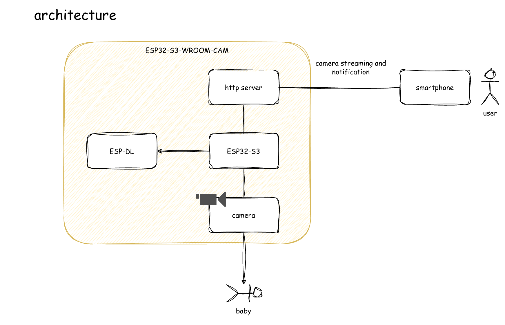
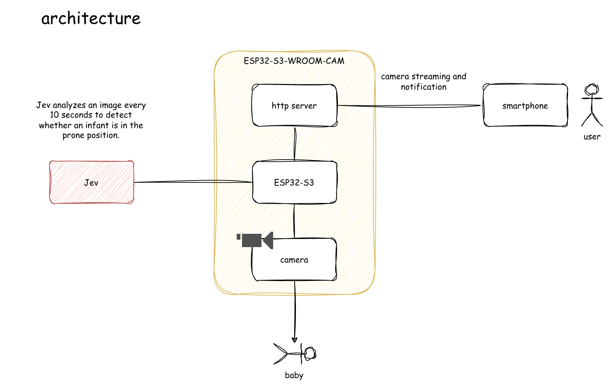

# prone-guard

Freenove ESP32-S3 WROOM CAM を使い、顔検知と `prone-like` 推定を監視して状態を公開するプロジェクトです。

`espressif/human_face_detect` によるローカルの `prone-like` 推定と、
Jev 1.14 に画像を送る姿勢判定を Web 管理画面で切り替えます。
ローカル推定は顔検知ベースの近似です。Jev の実画像での識別精度は未検証です。



## 目的

- ESP-IDF + ESP-DL でローカル推論を行う。
- Jev を選択した場合は、HTTPS で外部 API に画像を送る。
- Wi-Fi STA で既存アクセスポイントへ接続する。
- HTTP サーバでカメラ映像を配信し、`OK / UNKNOWN / NG (prone-like)` を公開する。

## モチベーション

乳幼児のうつ伏せを検出するために、感圧センサー、赤外線カメラ、光学カメラなど様々なセンサーを用いた IoT デバイスは確かに医療機器基準レベルで確実性がありますが、その分、高価になりがちです。私の知る限りでは保育施設は昨今、経済状況が厳しく、人材不足でもあり手軽に導入できるものではないと思ってます。仮にレンタルだとしても付属の SaaS に加入しないといけなかったりして結局金銭的費用がかかります。そこで、光学カメラだけでうつ伏せ防止につながるデバイスを作りたいと考えました。

光学カメラで捉えた映像からある程度判定できるよう、数学的に計算可能なロジックを作成し本プロジェクトに導入しました。

## Jev の設定と検証



1. ESP-IDF **6.0.3**、ESP-DL **3.3.14**、human_face_detect **0.5.1** でビルドする。
2. Web 管理画面の `/` を開く。
3. API key と閾値を入力し、判定方式を `Jev 1.14` にして保存する。
4. 判定結果またはエラーを画面と `/health` で確認する。

- 撮影は VGA (640×480)、画面表示とローカル推論は 320×240。
- ブラウザ未接続でも撮影と推論を継続する。
- Jev は 10 秒周期で送信する。8 秒でタイムアウトし、再送しない。
- タイムアウト後の送信は次の 10 秒周期に行う。
- 閾値の初期値は 0.5。判別不能と通信失敗は `UNKNOWN` とする。
- 同じ画像に顔存在の Noul と顔座標の Box を問い合わせる。
- 顔存在確率が 0.5 以上で、有効な座標があれば CSS の赤枠を表示する。
- 顔枠の取得失敗は画面にエラーを表示し、正常な姿勢判定は維持する。
- 顔枠は次回結果まで維持するため、現在の映像と位置がずれる場合がある。
- API key、判定方式、閾値は NVS に保存し、再起動後も維持する。
- API key の空欄保存では既存の key を変更しない。
- API key は画面や取得 API に返さない。管理画面の入力通信は HTTP。
- 外部 API の証明書検証のため SNTP で時刻を同期する。
- Jev の接続には、プロジェクト内の `main/gts_root_r4.pem` を使う。
- 接続先のルート認証局が変わった場合は、証明書を更新する。
- Jev の画像入力は実験機能。実機配信と識別精度は別途検証する。

自動テスト (ESP-IDF の環境を有効化した後):

```sh
idf.py build
./tests/run.sh
node tests/test_ui.cjs
```

別のビルドディレクトリを使う場合は、テストに
`IDF_BUILD_DIR=/absolute/path/to/build` を指定する。

## 現在の状態

- プロジェクト雛形を作成済み。
- `main/main.c` に Wi-Fi STA 接続、`GET /`、`GET /health` の最小実装を追加済み。
- `GET /stream` は MJPEG 配信を実装済み（カメラ初期化失敗時のみ `503`）。
- 顔矩形の時系列から `missing_ms`、`pre_disappear_move_px`、`pre_disappear_area_drop` を算出し、`prone-like` を推定するロジックを実装済み。
- 顔検知成立時のみ、配信映像の上に CSS の赤枠を表示する。
- Web UI は `OK: 顔検出`、`UNKNOWN: 顔未検出`、`NG: prone-like` を表示する。
- `main/prone_inference_bridge.cpp` で `human_face_detect_msr_s8_v1.espdl` と `human_face_detect_mnp_s8_v1.espdl` の2モデルを用いた推論実装を追加済み。
- ESP-DL と `esp32-camera` 依存は `main/idf_component.yml` に追加済み。

## prone-like 判定ロジック概要

`prone-like` は専用モデルではなく、顔検知結果の時系列からヒューリスティックに推定しています。大まかな流れは以下のとおりです。

1. 各フレームで顔検知を実行し、`is_face_detected == true` かつ `confidence >= 0.35` を生の顔検知成立とみなします。
2. 生の顔検知があった直近 `1200ms` は顔が見えているものとして扱い、その間は `OK` を返します。
3. 顔が見えている間は、最新 `6` 件までの顔矩形履歴から中心座標と面積を保存します。
4. 顔が見えなくなった瞬間に、直前 `1500ms` 以内の履歴を使って以下を計算します。
   - `pre_disappear_move_px`: 顔中心がどれだけ移動したか
   - `pre_disappear_area_drop`: 顔面積がどれだけ縮んだか
5. 顔が見えない時間 `missing_ms` と上記 2 指標から `prone_like_score` を加点式で算出します。

スコア加点条件は実装上、以下です。

- `missing_ms >= 2000` で `+0.55`
- `missing_ms >= 5000` で `+0.20`
- `pre_disappear_move_px >= 24px` で `+0.25`
- `pre_disappear_area_drop >= 0.20` で `+0.20`

最終的に `prone_like_score >= 0.70` なら `NG (prone-like)`、未満なら `UNKNOWN` です。顔が再び見えたら消失時間とスコアはリセットされ、状態は `OK` に戻ります。

## ドキュメント

- 要件定義: `docs/REQUIREMENTS.md`
- 設計書: `docs/DESIGN.md`
- 仕様書: `docs/SPECIFICATIONS.md`
- 実装 TODO: `docs/TODO.md`
- 環境構築手順: `docs/SETUP.md`
