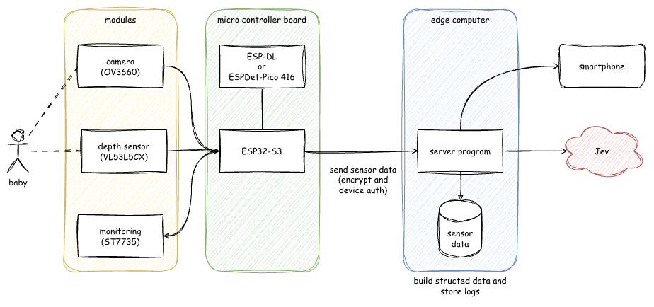

# prone-guard

Freenove ESP32-S3 WROOM CAM と VL53L5CX から、顔検知と 8×8 深度を毎秒送信する試作システムです。
エッジ側の Rust アプリは、認証済みの観測を SQLite に保存します。
3 分ごとに直近 3 分のデータを Jev に渡し、うつ伏せ / 非うつ伏せ / 判定不能を記録します。

- ファームウェア: ルートの ESP-IDF プロジェクト。
- エッジアプリ: `edge/`、Rust 1.99.1 / edition 2024。
- 対象 OS: macOS 27.x、Debian 13.7。
- 保存: 最大 6 時間、全ベッド合計 100MB。容量制限を優先します。
- 管理画面: HTTPS とデバイス固有の管理者認証。
- 映像ストリーミングとマイコンからの Jev 呼出しは廃止しました。
- ST7735（128×160px）に深度マップを各ゾーン 16×16px、64 階調で表示します。下部に文字を 2 行表示します。基本表示と横ずれ修正はユーザによる実機確認済みです。

## Architecture



## 初期設定から動作確認まで

以下を上から順に進めてください。

### 1. 開発環境を用意する

用意するもの:

- Freenove ESP32-S3 WROOM CAM、VL53L5CX を搭載した Conta 基板、配線、データ通信対応の USB ケーブル。
- 深度マップ表示用の ST7735 搭載 TFT（1.8-inch、128×160px、18bit、8 ピン SPI）と BL 用の 330Ω 抵抗。
- macOS 27.x または Debian 13.7 のコンピュータ。
- マイコンとエッジが相互通信できる LAN と、2.4GHz の WPA2 対応 Wi-Fi。ゲスト Wi-Fi などの端末間通信制限を解除する。
- SDK・依存ライブラリの取得、マイコンの時刻同期（`pool.ntp.org`）、Jev API に接続できるネットワーク。
- Jev による判定も試す場合は Jev API key。スクリプト内で非表示入力できる。キーなしでも観測の送信・保存は確認できる。

macOS では Command Line Tools と [Homebrew](https://brew.sh/) を導入し、次を実行します。
`xcode-select --install` で表示されるインストール画面の完了を待ってから先へ進んでください。
導入済みと表示される場合は再インストール不要です。

```sh
xcode-select --install
brew install git openssl@3
brew tap espressif/eim
brew install --cask eim-gui
```

Debian では次のパッケージを導入します。
ESP-IDF Installation Manager（EIM）は [Espressif の公式配布ページ](https://dl.espressif.com/dl/eim/) から使用環境に合う Linux 版を導入してください。

```sh
sudo apt update
sudo apt install git curl python3 python3-venv python3-pip openssl build-essential cmake ninja-build pkg-config ca-certificates libudev-dev libusb-1.0-0
```

EIM を開き、ESP-IDF **6.0.3** と ESP32-S3 用ツールをインストールします。
別のバージョンを選ばないでください。ESP-DL と顔検知モデルはプロジェクトのビルド時に取得します。

Rust は [公式の rustup インストーラ](https://rust-lang.org/tools/install/) で導入します。
導入後、同じターミナルで次を実行します。

```sh
source "$HOME/.cargo/env"
rustup toolchain install 1.99.1 --profile minimal --component rustfmt --component clippy
export RUSTUP_TOOLCHAIN=1.99.1
rustc --version
```

リポジトリを取得し、ルートへ移動します。clone 済みなら `git clone` は不要です。
SDK とリポジトリは、空白を含まないパスに配置してください。

```sh
git clone https://github.com/tkumata/prone-guard.git
cd prone-guard
```

**以降のコマンドは、特記がなければ全てこのルート（`README.md` があるディレクトリ）で実行します。**
新しいターミナルを使う場合も、このルートへ移動してください。

**ESP-IDF の環境有効化は `setup.py` が行います。手動で `source export.sh` や activate を実行する必要はありません。**
スクリプトは次の順で SDK を決め、必ずその SDK の `export.sh` を読み込みます。

1. 環境変数 `IDF_PATH` がある場合は、その SDK を使う。
2. EIM の標準配置 `~/.espressif/tools/activate_idf_v6.0.3.sh` がある場合は、そこから SDK・ツールの配置情報を取得する。
3. どちらもない場合は、`export.sh` が置かれている SDK ディレクトリを対話入力してもらう。

その環境の Python でスクリプトを続行するため、ビルドと USB 初期設定にも同じ SDK 環境が引き継がれます。
`export.sh` の実行に失敗した場合や SDK の版が 6.0.3 と異なる場合は、実機への書込み前に停止します。

macOS では証明書生成に Homebrew の OpenSSL を使うため、次を実行します。

```sh
export PATH="$(brew --prefix openssl@3)/bin:$PATH"
openssl version
```

#### VS Code を使用する場合

VS Code に ESP-IDF 拡張（`espressif.esp-idf-extension`）と rust-analyzer（`rust-lang.rust-analyzer`）を導入し、リポジトリのルートフォルダを開きます。
コマンドパレットの `Preferences: Open Workspace Settings (JSON)` から、`.vscode/settings.json` に次を設定してください。
既に設定がある場合は、既存の項目を残して追加します。

```json
{
  "rust-analyzer.linkedProjects": ["./edge/Cargo.toml"],
  "rust-analyzer.server.extraEnv": {
    "RUSTUP_TOOLCHAIN": "stable"
  },
  "idf.customExtraVars": {
    "IDF_TARGET": "esp32s3"
  },
  "idf.flashType": "UART",
  "idf.currentSetup": "/path/to/.espressif/v6.0.3/esp-idf",
  "idf.extensionActivationMode": "detect"
}
```

コマンドパレットで `ESP-IDF: Select Current ESP-IDF Version` を実行し、ESP-IDF **6.0.3** を選択します。
第 2 節の配線・USB 接続後に、`ESP-IDF: Select Port to Use (COM, tty, usbserial)` でボードのポートを選択してください。
ボード検出に拡張を使用するため、`idf.extensionActivationMode` は `detect` のままにします。

拡張は SDK の絶対パスを `idf.currentSetup` に保存します。
個人のパスやポートを共有しないため、`.vscode/settings.json` は Git の追跡対象から除外しています。
設定は各環境で管理し、`git add -f` で追跡対象に戻さないでください。
既存の clone で本変更を取り込む場合は、更新前に設定ファイルをリポジトリ外へ退避し、更新後に戻してください。

### 2. 配線して USB 接続する

電源と USB を外し、実際の端子表記を確認してから、マイコンと深度センサーを配線します。

| Conta     | Freenove |
| --------- | -------- |
| SCL       | GPIO21   |
| SDA       | GPIO14   |
| IO4 / INT | GPIO47   |
| GND       | GND      |
| 3.3V      | 3V3      |

Conta は Switch Science の VL53L5CX 搭載品（商品番号 10281）を対象とします。
IO4 は Conta 側の INT 端子名であり、Freenove の GPIO4 ではありません。現行コードは I²C ポーリングで取得するため、INT 配線は省略できます。
カメラは GPIO4 / GPIO5 の I2C0、Conta は GPIO14 / GPIO21 の I2C1 を使用します。
既存のビルド設定を再利用する場合は、[SETUP の I²C 設定](docs/current/SETUP.md#21-深度センサー) も確認してください。

TFT は、1.8-inch、128×160px、ST7735 の 8 ピン SPI モジュールを縦向きで使用します。
電源を外してから次のとおりに接続してください。

| TFT | Freenove |
| --- | --- |
| GND | GND |
| VCC | 3V3 |
| SCL | GPIO1 |
| SDA | GPIO2 |
| RES | GPIO42 |
| DC | GPIO41 |
| CS | GPIO38 |
| BL | 330Ω の直列抵抗を介して 3V3 |

専用資料がないため、3.3V、BL の電流制限ありで初期確認します。
SCL / SDA は SPI の信号であり、Conta の I²C と並列に接続しません。
GPIO38 を使用するため microSD カードは挿入しないでください。
GPIO2 の基板上 LED は転送で点灯状態が変わります。
GPIO41 / GPIO42 の外部 JTAG は併用できません。
電源条件とパネル調整は [TFT の接続手順](docs/current/SETUP.md#22-tft-st7735) を確認してください。
表示失敗はログに記録し、表示処理の失敗で取得・送信を停止しません。
SPI の成功だけでは、パネル接続や実際の描画成功を確認できません。
配線・視認性・周期・電源は実機で確認が必要です。

Conta の測距時には約 100mA が必要です。電源に余裕を持たせてください。
カメラの接続を確認し、Freenove の **ESP32-S3 ネイティブ USB 側**をコンピュータへ接続します。
現行の初期設定は USB Serial/JTAG を使用します。

### 3. LAN のアドレスを確認する

このスクリプトは、USB 接続したコンピュータをエッジとして起動します。
ルーターの DHCP 予約で、エッジとマイコンの **別々の IPv4 アドレス**を確保してください。
スクリプトはルーターや OS のネットワーク設定を変更しません。
マイコンのファームウェアも DHCP を使うため、IP の入力だけではアドレスは固定されません。

エッジの現在の IP は、macOS では「システム設定 → ネットワーク → 接続中のインターフェイス → 詳細 → TCP/IP」、Debian では `ip -4 addr` で確認できます。
マイコンの MAC アドレスが不明な場合は、基板の表示や既存の記録を確認します。個別に USB で調べる場合は、EIM の 6.0.3 の「Open IDF Terminal」で次を実行できます。この診断用ターミナルの起動は `setup.py` の実行には不要です。

```sh
python3 -m serial.tools.list_ports -v
# 表示された実際のポートへ置き換える。Debian の例は /dev/ttyACM0。
esptool --chip esp32s3 --port /dev/cu.usbmodem1234561 read-mac
```

表示された Wi-Fi MAC アドレスをマイコンの DHCP 予約に使用します。
端末間通信が制限されたゲスト Wi-Fi を避け、OS のファイアウォールで LAN からの TCP 8443 番への接続を許可してください。

### 4. セットアップスクリプトを実行する

**開発ツールを導入して USB 接続した後、`python3 tools/setup.py` を実行します。** スクリプトが `export.sh` による ESP-IDF 環境の有効化、設定生成、ビルド、確認付き eFuse 準備・flash、USB 初期設定、エッジ起動、接続確認を順に行います。

通常のターミナルで、リポジトリルートから実行します。ESP-IDF の `export.sh` はスクリプトが読み込みます。
**ビルド、flash、USB 初期設定、エッジの起動は、このスクリプトが実行します。別々にコマンドを実行する必要はありません。**

```sh
python3 tools/setup.py
```

スクリプトは次の順に進みます。

1. `export.sh` を読み込み、SDK の Python で続行する。Rust、ESP-IDF 6.0.3、OpenSSL、USB 用 Python モジュールを確認し、不足があれば実機へ書き込まず停止する。
2. USB ポートを一覧表示し、接続した ESP32-S3 のポートを入力してもらう。ポートが分かる場合は `python3 tools/setup.py --port /dev/ttyACM0` のように指定できる。
3. 初回は以下を対話入力し、生成内容を確認してから証明書・鍵・設定を `edge/local/` に作成する。既に設定があれば、鍵を生成し直さず再利用する。
4. 設定と証明書の整合性、秘密ファイルの権限、このコンピュータの指定 IP と TCP 8443 番が使用可能かを検査する。
5. ファームウェアを `build/setup/` に、エッジアプリを `edge/target/` にビルドする。既存のルートの `sdkconfig` や他のビルド設定は再生成しない。
6. 実機への書込みを確認する。`y` で進めた場合、まず eFuse を読み取る。既存の KEY0 が `HMAC_UP` なら再利用する。
7. KEY0 が未使用の場合だけ、対象 MAC と不可逆な変更を示す。指定された `BURN <MAC>` を入力した場合だけ HMAC キーを準備して書き込み、結果を再確認する。別用途・保護済み・判定不能なブロックには書き込まない。
8. ファームウェアを flash し、同じ実機の USB ポートが戻るのを待って、Wi-Fi・証明書・機器別キーを USB で設定する。
9. Jev API key が環境変数 `JEV_API_KEY` にない場合は非表示で入力してもらい、エッジアプリを起動する。キーの入力は空欄で省略できる。
10. CA と IP を検証した HTTPS で、エッジの受付と実機の Wi-Fi・時刻同期・カメラ・深度・送信成功を確認する。全て確認できた場合だけ「セットアップ完了」と表示する。

初回の設定入力:

| 入力 | 内容 |
| --- | --- |
| エッジの IPv4 アドレス | このコンピュータの DHCP 予約した LAN の IP |
| デバイスの IPv4 アドレス | マイコンの DHCP 予約した IP |
| Wi-Fi SSID | マイコンが接続する 2.4GHz の Wi-Fi |
| Wi-Fi パスワード | ASCII の 8〜63 文字。入力は非表示 |
| ベッド ID | 英数字・`_`・`.`・`-` の 1〜64 文字。空欄は `bed-01` |
| カメラの設置方向、深度マップの向き | 実測した方向。不明なら空欄で `未確認` |

**eFuse の書込みは取り消せません。** 対象実機と MAC を確認してから指定文字列を入力してください。
既存機の flash では、旧 storage の先頭 64KiB が `secure_nvs` になります。独自に storage を使っていた場合は実行前に退避してください。
既定の KEY0 が別用途で使用中の場合、このスクリプトは自動で別ブロックを選ばず停止します。

生成物は `edge/local/` に権限 `0600`、ディレクトリは `0700` で保存します。
`config.json` はエッジ用、`device.json` は USB 初期設定用、`ca.pem` は接続確認と管理画面用です。
CA・エッジ・デバイスの証明書と秘密鍵、書込みに使用した `nvs-hmac.bin` もここに保存されます。
秘密ファイルは公開せず、HMAC キーのバックアップをリポジトリ外にも保管してください。

現行の USB 初期設定は開発用の平文 JSON です。信頼できるコンピュータと USB ケーブルを使用します。
商品用の認証付き USB 登録とセットアップ画面は未実装です。

### 5. 動作中の確認と停止・再起動

セットアップ完了後も、スクリプトは起動したエッジアプリを動かし続けます。
終了するときは **`Ctrl-C`** を押します。失敗・中断時も、スクリプトが起動したエッジだけを停止し、鍵・設定・DB は保持します。

管理画面は、スクリプトが表示したマイコンの HTTPS URL で開きます。
ユーザ名は `admin`、パスワードはローカルの `edge/local/device.json` の `admin_password` です。
ブラウザで利用する場合は、`edge/local/ca.pem` を信頼する CA として登録してください。
macOS は「キーチェーンアクセス」で CA 証明書を読み込み、その「信頼」で SSL の信頼を設定します。
Debian で OS の CA ストアを使う場合は次を実行します。ブラウザが独自の CA ストアを使う場合は、そのブラウザにも同じ CA を登録します。
この OS への登録はブラウザ用であり、スクリプトの接続確認には不要です。

```sh
sudo install -m 0644 edge/local/ca.pem /usr/local/share/ca-certificates/prone-guard-local-ca.crt
sudo update-ca-certificates
```

証明書警告の無視や `curl -k` で検証を回避しないでください。
別のターミナルで HTTPS 受付を確認する場合は、同じリポジトリルートから次を実行します。IP は設定したエッジの IP へ置き換えます。

```sh
curl --fail --cacert edge/local/ca.pem https://192.168.1.50:8443/health
```

`"receiver":"ready"` はエッジの受付と保存領域が使用可能な状態です。
Jev の判定結果は、エッジを起動したターミナルの標準エラーに、3 分周期で `posture_result` として出ます。
十分な観測が揃った周期で API を呼び出します。キーがない場合は、十分な観測があっても `jev_not_configured` を記録します。
セットアップの接続確認には、Jev の実 API の成功や姿勢の識別精度の評価は含みません。
本構成の実機・実 API による識別精度は未確認です。

通常の再起動では、マイコンへ給電し、エッジのリポジトリルートで次を実行します。
再ビルド・eFuse 書込み・USB 初期設定は不要です。Jev を使う場合は、そのターミナルにも `JEV_API_KEY` を設定してください。

```sh
edge/target/debug/prone-guard-edge edge/local/config.json
```

セットアップが途中で失敗した場合は、原因を解消して `python3 tools/setup.py` を再実行します。
既存の鍵と設定を再利用しますが、ビルド・確認付き flash・USB 初期設定・接続確認は再度行います。
使用中の鍵や設定を削除してやり直さないでください。

| 停止した箇所 | 対処 |
| --- | --- |
| ESP-IDF の確認 | SDK 6.0.3 とツールの導入を確認する。`IDF_PATH` が別の SDK を指している場合は修正または解除し、`setup.py` を再実行する |
| USB の選択・書込み | ネイティブ USB 側、データ通信対応ケーブル、正しいポートを確認し、シリアルモニタを終了する |
| Debian の USB 権限 | `sudo usermod -aG dialout "$USER"` を実行し、ログインし直して `setup.py` を再実行する |
| eFuse の検査 | 既存の KEY0 の用途を確認する。別用途のキーを上書きしない。書込み失敗後にキーファイルを再生成しない |
| 設定・証明書の検査 | IP、CA、証明書と秘密鍵の組、ファイルの権限、エッジと機器のキーの対応を確認する。不完全な既存ファイルを削除して進めない |
| IP またはポートの使用可否 | エッジの IP がこのコンピュータに割り当てられているか確認する。同じ TCP 8443 を使う既存のエッジは先に終了する |
| 実機の接続確認 | Wi-Fi、DHCP 予約、端末間通信、TCP 8443、`pool.ntp.org` への時刻同期、センサー配線・電源を確認する |

個別の手動コマンドで診断する場合は [SETUP](docs/current/SETUP.md) を参照してください。

## TFT 深度マップの見方

画面上部の 128×128px にセンサーの 8×8 ゾーンを表示します。
1 ゾーンは 16×16px で、**近いほど白く、遠いほど黒く**なります。
RGB666 の 64 階調を使い、各画素の明るさで距離を表します。

| 見え方 | センサーからの距離の目安 |
| --- | --- |
| 白 | 0m |
| 明るい灰色 | 1m（1000mm） |
| 中間の灰色 | 2m（2000mm） |
| 暗い灰色 | 3m（3000mm） |
| 黒 | 4m（4000mm） |
| 黒地に赤い `×` | 測距値が無効なゾーン |

表示範囲は 0〜4m に固定し、フレームごとの自動正規化は行いません。
黒は遠距離側の有効値であり、欠測の赤い `×` とは異なります。
4m を超える値や無効な測距状態も `×` になります。
視野との向きの対応は、設置時に対象物を動かして確認してください。

下部 32px には、8×16px の文字を 2 行表示します。
1 行目はマップ全体の状態、2 行目は凡例 `0-4m NEAR=WHITE` です。

| 状態 | 意味 |
| --- | --- |
| `DEPTH` | 有効な測距値を含むマップを表示中。一部のゾーンが `×` の場合もある |
| `NO VALID` | 最新データの全ゾーンが無効。マップは全て赤い `×` |
| `NO DATA` | 起動後、深度データをまだ取得していない。マップは消去 |
| `STALE` | 最後の取得成功から 5 秒を超えた。マップは消去 |
| `ERROR` | 深度の取得エラー。マップは消去 |

詳細は [表示仕様](docs/current/SPECIFICATIONS.md#7-tft-深度マップ) を参照してください。
基本表示と列オフセット +2 の修正は、2026-11-04 にユーザが実機で確認しました。
電源・周期の測定と障害試験の個別結果は未確認です。

## 登録管理エッジのセットアップ

登録 DB、アプリ内の CA・証明書生成と更新、mDNS 広告を検証する場合は、通常のセットアップとは別に次を実行します。
Rust と OS のビルドツールを導入したリポジトリルートで実行してください。ESP-IDF と USB 接続はこのモードには不要です。

```sh
python3 tools/setup.py --registration
```

このモードも、設定ファイルの生成だけで終わらず、エッジのビルド・起動・証明書を検証した HTTPS の確認まで行います。
生成先は `edge/registration-local/` です。通常の `edge/local/` は変更しません。
既存の登録管理設定と DB は再利用し、終了は `Ctrl-C` です。同じ TCP 8443 を使う通常のエッジは先に終了してください。

**商品用 USB 登録との統合とセットアップ画面は未実装です。**
このモードの起動成功を、機器登録の完了とは扱いません。通常の `setup.py` の前段でもありません。
旧 `device.json` で設定した機器を、登録管理エッジへ登録することはできません。
再起動時は `edge/target/debug/prone-guard-edge edge/registration-local/config.json` を使用します。
CA・秘密鍵・登録状態を保持する `registrations.sqlite` は削除しないでください。
独立した Security 2 検証機の手順は [SETUP 第 9 節](docs/current/SETUP.md#9-security-2-と-usb-の相互運用検証) にあります。

## 開発用の自動テスト

セットアップのビルドを終えたリポジトリルートで、開発用のテストを個別実行する場合のコマンドです。
このテスト用ターミナルは EIM の 6.0.3 の「Open IDF Terminal」を使用します。セットアップ本体では、この環境有効化は自動で行われます。
UI テストには Node.js が必要です（macOS は `brew install node`、Debian は `sudo apt install nodejs`）。
HTTPS テストは、ビルドしたエッジの実行ファイルを使用します。

```sh
IDF_BUILD_DIR=build/setup ./tests/run.sh
node tests/test_ui.cjs
python3 -m unittest discover -s tests -p 'test_provision.py'
python3 -m unittest discover -s tests -p 'test_setup.py'
cargo +1.99.1 test --manifest-path edge/Cargo.toml --locked
cargo +1.99.1 clippy --manifest-path edge/Cargo.toml --locked --all-targets -- -D warnings
cargo +1.99.1 build --manifest-path edge/Cargo.toml --locked
python3 -m unittest discover -s tests -p 'test_edge_https.py'
```

自動テストは実機への書込みを行いません。eFuse の結合テストは SDK の仮想デバイスを使います。
USB・配線・電源・センサーの方向・実 API の識別精度は実機で別に確認してください。

## 関連文書

- [環境構築と運用の詳細](docs/current/SETUP.md)
- [要件](docs/current/REQUIREMENTS.md)
- [仕様](docs/current/SPECIFICATIONS.md)
- [設計](docs/current/DESIGN.md)
- [商品向けの接続・登録設計](docs/current/CONNECTION.md)
- [実装計画と検証状態](docs/plans/active/2026-10-28-issue-15-edge-sensors.md)
