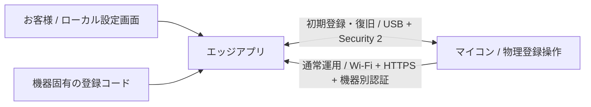

# マイコンとエッジの接続・登録設計

お客様だけで安全に接続を完結できることを必須要件とする。
本書は商品向けの接続仕様を定義する。
実装・検証状態は [実装計画](../plans/active/2026-10-28-issue-15-edge-sensors.md)、判断理由は [ADR-0002](../adr/0002-customer-device-pairing.md) で管理する。

## 1. 採用する接続方式

初期登録は USB、通常のセンサー送信は既存の Wi-Fi STA と HTTPS を使用する。
USB も信頼済みとは扱わず、機器固有の登録コードで認証した暗号化セッションを使う。
初回登録、設定変更、交換、復旧をエッジアプリ内のセットアップツールに集約する。
ツールはローカル設定画面を提供し、認証・資格情報管理・接続確認の処理をアプリ本体と共用する。
初回だけでなく再実行と途中失敗からの再開に対応し、使用中の鍵や無関係な機器設定を上書きしない。
お客様にターミナル、SDK、証明書生成、CA 登録、固定 IP、秘密ファイル編集を要求しない。
登録専用クラウド、スマートフォン、Bluetooth アダプタを必須にしない。
Jev のインターネット接続は従来どおり必要だが、機器登録の認証基盤には使わない。

## 2. お客様の操作

1. 対応 OS 用の配布パッケージをインストールし、エッジアプリを起動する。
2. セットアップツールの「機器を追加」を開き、付属のデータ対応 USB ケーブルでマイコンを接続する。
3. 機器の登録ボタンを 3 秒押し、同梱カードの登録コードを入力する。
   QR の読取りが可能な環境では同じコードを読み込める。カメラは必須にしない。
4. 表示された機器 ID をカードと照合し、Wi-Fi、ベッド ID、設置情報を入力する。
5. 「接続する」を選ぶ。アプリが認証情報を生成・設定し、Wi-Fi 経由の接続を確認する。
6. 「接続完了」の表示後に USB を外し、設置する。

Wi-Fi 接続、エッジ認証、登録の確定まで確認してから完了を表示する。
USB への書込み成功だけでは完了にしない。
失敗時は Wi-Fi、ネットワーク探索、時刻、認証、保存のどこで失敗したかと、再試行方法を表示する。
秘密の内容や内部のスタックトレースをお客様向けエラーに含めない。

対応環境は、マイコンとエッジが相互通信できる同一 LAN とする。
DHCP と mDNS が利用可能で、無線クライアント間の通信が遮断されていないことを条件にする。
条件に合わない場合はアプリが接続確認で案内し、IP 手入力や認証の省略に誘導しない。
macOS と Debian の両方で、インストールから USB 権限設定まで配布パッケージで完結させる。

## 3. 製造時に準備するもの

| 項目 | 製造側の責任 |
| --- | --- |
| 機器 ID | 機器ごとに一意な 128bit の乱数を 32 桁の小文字 16 進文字列にし、カードと機器に表示する |
| 登録コード | 暗号学的乱数の 256bit 値。機器ごとに異なる値をカードへ印刷する |
| 初期認証情報 | Security 2 の username を機器 ID とし、固有 salt と SRP verifier を保護領域に保存する |
| 秘密の保護 | HMAC eFuse、暗号化 NVS、Flash Encryption の Release 設定を出荷前に設定・検査する |
| 実行コードの保護 | Secure Boot v2、JTAG と不要な ROM 書込み経路の制限を設定・検査する |
| 更新・復旧 | 署名付き更新、失敗時の復旧、脆弱な版への巻戻し防止を出荷前に検証する |

共通の登録コードや、MAC アドレスから導出した秘密は使用しない。
カードは外箱の公開ラベルと分け、開封後に所有者だけが保管できる形で提供する。
製造ログ、出荷一覧、サポート用ログへ登録コードを残さない。
コード原文は機器へ保存せず、初期化しても製造時の ID と verifier を維持する。
アプリも初期登録コードを永続保存せず、登録・復旧の認証後に入力内容を破棄する。
お客様のアプリから eFuse を書き換えない。

出荷時の保護を有効にした状態で USB 登録が動くことを確認する。
USB シリアル機能と JTAG 機能を同一視して、USB 全体を無効にしない。
現在の Freenove 基板でこの組合せを確認するまで、商品化可能とは判定しない。

## 4. 初期登録の認証と確定

ESP-IDF の `protocomm_security2` による SRP6a と AES-GCM を採用する。
暗号方式を自作せず、エッジ側も同じ仕様に対応する検証済みの実装を使用する。
Security 0、平文 JSON、コードをそのまま USB へ送る方式への切替は設けない。
登録コードを知る相手同士でセッションを確立し、機器 ID を認証結果に結び付ける。
USB の VID/PID、シリアル番号、自動検出結果だけでは機器を信用しない。

登録受付は、USB 接続中の物理操作から 120 秒間、同時に 1 セッションだけとする。
認証に 5 回失敗した場合は受付を閉じ、60 秒後の物理操作から再開できるようにする。
再起動だけでは失敗回数を解除できないようにする。
未登録でも、電源投入だけでは設定変更を受け付けない。
認証後の設定・接続確認は全体 180 秒以内とし、USB 切断時はセッション鍵を破棄する。
失敗回数以外の受付期限は再起動後へ持ち越さず、受付を閉じた状態で起動する。

暗号化した設定には、機器 ID、エッジ ID、登録世代、取引 ID、要求番号、操作を含める。
別機器への転送、改ざん、再送、順序の入替え、別セッションの要求を拒否する。
USB フレームは最大 32KiB、復号後の設定は最大 16KiB に制限する。
未認証時は必要なハンドシェイク以外の設定処理を実行しない。

ESP-IDF 6.0.3 の標準 `protocomm_console` は UART 用で、行バッファが 256 bytes である。
現在の USB Serial/JTAG にそのまま接続できるとは扱わない。
既存 USB I/O と公開 `protocomm` API を接続する、長さ上限付きの transport を実装する。
Security 2 のハンドシェイクと AES-GCM の nonce 管理は公式実装に任せる。
エッジ側の SRP・暗号処理、シリアル I/O、証明書生成、mDNS に必要な依存は実装前に版・保守状況を確認する。
今回の文書修正で、未選定の依存の導入まで承認済みとは扱わない。

### 登録状態

| 状態 | 許可する動作 |
| --- | --- |
| 未登録 | 物理操作と登録コードで初期登録。観測の送信は不可 |
| 登録準備中 | 新設定を未確定として保存し、専用の接続確認だけを行う |
| 登録済み | 登録先へ観測を送信。所有者の認証で管理。初期登録コードによる上書きは不可 |
| 復旧受付中 | USB と復旧用の物理操作と登録コードで、所有者を再設定できる |
| 失効済み | エッジは当該世代の観測とエッジ経由の管理要求を拒否。勝手に再登録しない |

アプリはエッジ固有 CA とサーバ証明書を生成し、機器別の送信用キーと所有者用の管理認証情報を発行する。
送信用と管理用には別々の 256bit 乱数を使う。登録コードとも共用しない。
CA 秘密鍵はエッジ内にだけ保存し、USB やマイコンへ渡さない。
マイコンの管理 HTTPS 秘密鍵は機器内で生成し、署名要求だけをエッジへ渡す。

エッジとマイコンは、新しい登録を未確定の世代として永続化する。
マイコンは新しい CA、ホスト名、送信用キーで `POST /v1/pairing/check` に接続する。
この API は準備中のキーを検証し、取引 ID と双方の ID に一致した接続だけを確認する。
準備中のキーでは観測の保存や管理操作を許可しない。
アプリは接続確認後に USB の認証済みセッションで確定を指示する。
マイコンの確定状態を認証済み USB で確認してから、エッジ側の同じ取引を有効にする。
その間に届く新キーの観測は拒否し、確定処理の記録から再開できるようにする。
同じ取引の再確定は同じ結果を返し、登録世代を重複発行しない。
双方の永続化と確定状態を確認した後にだけ「接続完了」とする。

USB 切断、電源断、保存失敗では、未確定の設定で通常送信を始めない。
再接続時は取引 ID と保存済み状態を照合し、再開または未確定分の取消しを行う。
確定応答だけ失われた場合は、所有者用の管理認証情報で状態を再確認する。
既存登録の設定変更は、マイコン側の確定前なら以前の設定を維持する。
片側だけ確定した場合は勝手に初期化・巻戻しをせず、認証後に同じ取引の確定を再開する。
設定と資格情報を別々に有効化せず、世代単位の原子的な保存・切替を実装する。

## 5. 通常通信と管理

通常通信は TLS 1.2 以上の HTTPS と、既存形式の機器別 Bearer token を使用する。
エッジは token の SHA-256、機器の登録状態・世代、許可ベッドを確認する。
マイコンは登録時に受け取ったエッジ専用 CA、証明書の期限、登録ホスト名を検証する。
公共 CA 全体や、別エッジの CA を接続先の信頼根に追加しない。
HTTP への切替、証明書検証の省略、自動リダイレクトを禁止する。
JSONL、1 秒周期、5 秒の全体期限、ベッド分離、入力検証は既存契約を維持する。

エッジ ID は初回に生成した 128bit の乱数から作り、再起動や IP 変更で変えない。
DNS 名は `pg-edge-<edge-id>.local` とし、サーバ証明書の SAN に入れる。
mDNS はこの名前から IP を探索するためだけに使い、探索結果を認証には使わない。
エッジ側の名前広告とマイコン側の mDNS 解決を実装し、URL を `.local` に変えるだけで対応済みとは扱わない。
DHCP による IP 変更後は再探索し、同じ CA とホスト名で認証する。
名前の競合や偽の応答では、別の機器を自動で信頼しない。
外部向けポート開放やルーターの固定 IP 設定を要求しない。

設定操作はエッジアプリのローカル画面から行い、機器の HTTPS 管理 API はアプリが認証して使用する。
お客様に機器の秘密、送信先 URL、証明書の入力を求めない。
機器の管理 API は既存の HTTPS・認証・Origin・入力検証を維持し、ブラウザからの直接操作を必須にしない。
アプリは機器ごとの管理証明書と登録時の公開鍵、機器 ID を照合してから管理要求を送る。
機器の管理名は `pg-device-<device-id>.local` とし、機器の証明書の SAN に入れる。
機器側の mDNS 広告とアプリ側の探索で IP の変更に対応し、CA・名前・公開鍵の検証で同じ機器を確認する。
アプリ内の通信クライアントだけが専用 CA を信頼し、OS やブラウザ全体の信頼設定を変更しない。
ローカル画面を Web で実装する場合は loopback のみに bind し、Host・Origin 検証、CSRF 対策、推測不能なセッション認証を必須にする。
LAN からローカル管理画面を操作できる設定は初期版に追加しない。

初期登録時の認証済み USB セッションで、エッジの OS 時刻を初期時刻として渡す。
通常運用の NTP は維持するが、未認証の時刻情報を根拠に信頼先を変更しない。
時刻が不正で証明書を検証できない場合は接続を停止し、USB の認証済み復旧へ案内する。
エッジの秘密は実行ユーザ限定の領域に保存し、OS の秘密保管機能を利用できる場合は使用する。
機器一覧、画面、取得 API、診断出力へ Wi-Fi パスワード、登録コード、認証キー、秘密鍵を返さない。

## 6. 更新・交換・解除・復旧

| 場面 | お客様の操作とシステムの動作 |
| --- | --- |
| Wi-Fi 変更 | USB 接続し、アプリが所有者として認証して新設定を確認・確定する |
| サーバ証明書更新 | エッジ・機器の管理用とも有効期限 365 日、残り 90 日で同じ CA・公開鍵・SAN の証明書へ自動更新する。失敗時は通知する |
| CA 更新・期限切れ | CA は 3650 日有効。残り 365 日でアプリが案内し、機器ごとに USB 認証して新しい信頼根へ切り替える |
| 機器別キー更新 | 所有者認証済みの USB 経路で新世代を確認・確定後、旧世代と旧キーを失効する |
| マイコン交換 | エッジで旧機器を失効させ、交換機を初期登録する。旧機器が不在でも失効できる |
| エッジ交換・紛失 | 新エッジに USB 接続し、登録コードと復旧操作で新しい CA・資格情報へ置き換える |
| 登録解除 | エッジで先に失効させる。接続可能なら機器側の Wi-Fi と運用資格情報も消去する |
| 譲渡・廃棄 | USB の所有者認証または登録コードを使う復旧認証で、Wi-Fi と運用資格情報を消去する。譲渡時はカードも渡す |

復旧操作は USB 接続中のボタン 10 秒長押しとし、通常登録の操作と区別する。
物理操作だけでは秘密の消去や別エッジへの再登録を行わず、コード認証と画面上の確認を要求する。
登録済み機器の通常 USB 管理では、アプリが保持する所有者用の管理認証情報で Security 2 を確立する。
初期登録コードが有効になるのは、未登録状態と物理操作による復旧受付中だけである。
旧エッジを利用できない復旧では、機器側で旧 CA と旧資格情報を破棄する。
旧エッジの記録を遠隔削除できたとは表示しない。旧エッジの保存データは別途消去が必要である。
自動更新前に既に期限切れとなった場合も、検証を省略せず USB で復旧する。
機器の管理証明書の更新は、現証明書を検証した所有者認証付き HTTPS で公開証明書だけを渡す。
更新 API は同じ機器内の公開鍵・CA・SAN と一致する更新証明書だけを受け付け、秘密鍵・信頼根・所有者の変更には使わない。
機器の秘密鍵や信頼根の交換は、所有者認証付き USB の登録世代切替で行う。
完全な登録解除後も、機器 ID、製造時の認証情報、eFuse の保護は維持する。
カードと所有者用の管理認証情報を両方失った場合の、認証を迂回する解除機能は設けない。

## 7. 保護する範囲と受入条件

LAN 上の第三者、偽のエッジ、偽の USB 機器、盗聴、改ざん、要求の再送、無断登録・再登録を対象にする。
登録コードと本体の両方を第三者に渡した場合や、エッジ OS 自体を侵害された場合を接続暗号だけで防げるとは扱わない。
悪意ある LAN による通信妨害は認証回避で解消せず、欠測・接続異常として表示する。
設計の採用だけでは安全性を確認済みとしない。

- 初めて使うお客様が、開発者の操作なしで配布パッケージの導入から接続完了まで行える。
- macOS と Debian の両方で、管理者による手作業の USB 権限調整や証明書設定が不要である。
- コード不一致、別の機器 ID、物理操作なし、受付時間外では設定を書き換えられない。
- USB の改ざん、再送、過大フレーム、途中切断、旧平文 JSON を拒否する。
- 登録途中・確定応答前後の電源断から復旧でき、未確定キーで通常観測を保存できない。
- 偽 mDNS、別エッジ、期限切れ・不正な証明書、別ベッド、失効キーを拒否する。
- IP 変更、再起動、Wi-Fi 切断から、同じ相手を検証して自動再接続できる。
- 旧キーを失効させた時点で、既存の keep-alive 接続も含めて旧キーの要求を拒否する。
- 証明書自動更新、期限切れからの USB 復旧、エッジ紛失時の交換を実際の操作で確認する。
- 出荷時の Secure Boot、Flash Encryption、デバッグ制限を有効にして同じ手順が動く。
- ログ・診断データに秘密がなく、LAN からローカル管理画面を操作できない。
- 登録情報を観測の保持期限処理で消去せず、失効を再起動後も維持する。

既存の試作テストは、これらの商品向け受入条件の合格証拠には流用しない。
実装タスクと未検証項目は [実装計画](../plans/active/2026-10-28-issue-15-edge-sensors.md) で管理する。

## 8. 根拠

- [ESP-IDF Protocol Communication](https://docs.espressif.com/projects/esp-idf/en/stable/esp32s3/api-reference/provisioning/protocomm.html): Security 2 と transport の分離。
- [ESP-IDF Security Overview](https://docs.espressif.com/projects/esp-idf/en/stable/esp32s3/security/security.html): 製造時の保護、通信・更新の保護。
- [ESP-IDF 6.0.3 ESP-TLS](https://docs.espressif.com/projects/esp-idf/en/v6.0.3/esp32s3/api-reference/protocols/esp_tls.html): CA と接続先名の検証。
- ローカルの ESP-IDF 6.0.3 の `components/protocomm/` の公開 API と console 実装を照合した。
  上記 stable 文書は調査時に v6.1 を指すため、6.0.3 に存在する機能と区別して参照した。
