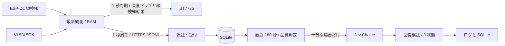

# センサー送信・エッジ判定の設計

## 1. 設計方針

マイコンのセンサー取得と、エッジ側の判定処理を分離する。
ドメインの入力検証と品質判定は、HTTP や SQLite へ依存させない。
ESP-DL で顔検知を行い、設定に応じて MSR + MNP と ESPDet-Pico 416 を選択する。
詳細な設計判断は [ADR-0001](../adr/0001-edge-sensor-processing.md) に記録する。
接続・登録の設計は [ADR-0002](../adr/0002-customer-device-pairing.md) と [接続設計](CONNECTION.md) に従う。

## 2. 全体構成

## 3. マイコンの責務

| モジュール | 責務 |
| --- | --- |
| `main.c` | タスク接続、Wi-Fi、時刻同期、管理 API |
| `prone_inference_bridge.cpp` | モデルの初期化、VGA 画像の反時計回り 90 度補正、顔検知 |
| `face_rotation.h` | 推論用の画面寸法、顔矩形・ランドマークのカメラ座標への変換 |
| `depth_sensor.c` | I²C と ULD の接続、測距結果の取得 |
| `depth_map.c` | 深度の階調変換、無効・欠測と顔検知結果の表示、RGB666 の分割描画 |
| `tft_display.c` | ST7735 の初期化と期限付き SPI 転送 |
| `telemetry.c` | 座標の面積変換、JSONL の生成 |
| `edge_sender.c` | HTTPS と認証ヘッダ、応答上限、通信期限 |
| `monitor_settings_json.c` | 管理設定の入力検証 |
| `monitor_settings.c` | 設定の NVS 保存、旧 Jev 設定の削除 |
| `device_security.c` | 暗号化領域の初期化、USB 設定、管理者認証 |
| `pairing_frame.c`、`pairing_usb.c` | 検証用ファームウェアが使用する登録フレームと USB transport |
| `index.html` | 管理フォームとデバイス状態の表示 |

`sensor_task` は最新の観測だけを共有する。
`sender_task` は観測と設定をコピーして通信する。
共有状態の mutex を保持したまま通信しない。
設定の世代が変わった場合は、旧送信結果で状態を更新しない。
通信が遅れた場合は観測を蓄積せず、次周期の最新値を送る。
DNS は lwIP の非同期処理を使用し、5 秒の全体期限内で待つ。
接続には解決済み IP を使い、TLS と Host には元の名前を使う。
期限切れの DNS 応答先は固定領域に保持し、解放済みメモリを参照しない。

両方の顔検知モデルを同じファームウェアのフラッシュ領域に格納する。
`sdkconfig.defaults` は両方のモデルを有効にする。既存の `sdkconfig` を再利用する場合は、`menuconfig` の **models: human_face_detect** で両方の flash 設定を有効にする。
`main.c` は起動時のモデル選択を保持し、推論処理は選択したモデルだけを初期化する。
ESPDet-Pico 416 を使う場合は、TLS 用の内部 RAM を確保するためセンサーと TFT のタスクスタックを PSRAM に配置する。
管理画面からの保存要求は、NVS 保存と HTTPS の成功応答の後に再起動する。

### TFT 表示の責務

TFT は最新の深度と顔検知結果を読むローカル表示とする。
表示はエッジや Jev に依存させない。
`depth_map.c` は I/O を行わず、深度と顔矩形の面積から RGB666 の 16 行を描画する。
顔の面積は描画引数で受け取り、0 は未検知・カメラ未取得・取得失敗を表す。
左右反転の設定値を引数で受け取り、描画時の参照列だけを変える。
状態文字と凡例の描画には左右反転を適用しない。
`tft_display.c` は SPI と GPIO、初期化、転送中のメモリを管理する。
表示変換を観測値、JSONL、判定入力へ反映しない。
表示契約は [TFT 仕様](SPECIFICATIONS.md#7-tft-深度マップ) に従う。

深度センサーは I2C1、GPIO14 / GPIO21、400kHz を使用する。
I²C バスの生成と深度デバイスの登録は `main.c` が担当する。
カメラの SCCB は新 I²C ドライバの I2C0 に固定する。
I2C1 の二重確保と旧・新ドライバの混在をビルド時に拒否する。
TFT は独立した SPI2_HOST を使用する。
配線と既存端子への影響は [SETUP](SETUP.md#22-tft-st7735) に記載する。

`sensor_task` は深度取得直後に距離、status、単調時計の時刻を公開する。
`tft_task` はスナップショットをコピーしてから mutex を解放する。
表示タスクは同じ mutex 内で左右反転設定と最新観測の顔検知結果もコピーする。
カメラ取得成功かつ顔検知成立時だけ、既存の面積を整数の px² として描画へ渡す。
同じスナップショットと時刻を使い、全 10 区画を順に描画して転送する。
全区画にはフレーム開始時の左右反転設定を使用する。
各区画は 128×16px、6144 bytes とする。
描画用バッファはタスクスタック外の PSRAM に確保する。
ドライバは送信データを専用の静的バッファへコピーする。
SPI のキュー待ちと完了待ちは、それぞれ 100ms に制限する。
タイムアウト後も記述子と送信バッファを保持する。
再初期化の前に未完了の転送を回収する。
転送が完了しなければ、新しい転送とパネルリセットを行わない。

表示要求は蓄積せず、1 秒周期で最新値だけを使用する。
表示失敗はログに記録し、5 秒以上空けて再初期化する。
取得・送信タスクを表示タスクより先に確保する。
表示タスクの確保失敗でも取得・送信を継続する。
SPI は未接続を検出できないため、描画成功は実機で別途確認する。

## 4. エッジの責務

| モジュール | 責務 |
| --- | --- |
| `measurement.rs` | 入力の意味、型、品質、180 秒の期間判定 |
| `store.rs` | SQLite、重複、保持期間、容量制限 |
| `config.rs` | 起動設定、秘密ファイル、キーとベッドの対応 |
| `registration.rs`、`registration_store.rs` | 登録世代と取引の状態管理、登録 DB、準備中の接続確認と失効 |
| `identity.rs`、`discovery.rs` | エッジの CA と TLS 証明書、mDNS 広告 |
| `security2.rs`、`pairing.rs` | 検証ツールが使用する Security 2 クライアントと USB 登録フレーム |
| `jev.rs` | 質問と回答契約、HTTPS 呼出し、応答検証 |
| `lib.rs` | HTTP とドメインの接続、周期処理、ログ |
| `main.rs` | TLS サーバ起動と終了 |

SQLite 操作は blocking worker 内で行う。
Jev の待機中は DB の mutex を解放する。
ベッド別の Jev 呼出しは並行実行し、前周期の要求を蓄積しない。
静的設定モードでは `devices` に 1〜64 件を指定する。登録管理モードでは `devices` を空にし、登録 DB の有効な機器を使用する。
判定窓の読出しは、ベッド・観測秒ごとに最大 1 件とする。

## 5. 保存設計

観測はベッド、起動 ID、シーケンス番号を主キーにする。
観測時刻と受信時刻を区別する。
保持期間には、実行中の時計巻戻しで後退しない時刻を使用する。
期限切れの記録は判定から除外し、1 秒周期の保守処理で削除する。
保守処理は Jev の応答待ちから独立して動作する。

SQLite は単一 writer、rollback journal、`synchronous=EXTRA` を使う。
DB 本体を予算の 48% 以下に制限し、ジャーナルの余裕を確保する。
既定の DB 上限は約 48MB であり、100MB 全てを原文に使用しない。
残りは rollback journal の最大成長とヘッダ等のために予約する。
一時表はメモリ内で処理する。
`max_page_count` と全関連ファイルのサイズ確認を併用する。
容量不足時は古い観測を小さな単位で削除し、空きページを再利用する。
判定記録も同じ DB に保存し、同じ保持期間と容量に含める。

## 6. 秘密と設定移行

管理画面の `tft_mirror_x` と `face_model` は、暗号化 `secure_nvs` に保存する。
NVS 内の値は 0 または 1 とし、不正な値を拒否する。
保存済み設定に左右反転項目がない場合は無効、顔検知モデル項目がない場合は MSR + MNP とする。
保存成功後だけ実行中の設定を切り替える。
設定 API は省略された左右反転項目の現在値を維持する。
USB 初期設定では未指定の左右反転を無効にする。

`secure_nvs` はオフセット `0x610000`、サイズ 64KiB とする。
管理設定の保存後に、`nvs` に残る Jev の `settings` blob を削除する。
Wi-Fi の新設定は暗号化領域へ保存する。
Wi-Fi ドライバの設定先は RAM とし、平文の新規保存を避ける。

現行試作は、TLS 秘密鍵と管理者認証情報を USB の平文 JSON で投入する。
HMAC eFuse キーは事前設定を要求し、マイコンのファームウェアとエッジアプリから生成しない。
開発者用の `tools/setup.py` は、既定の KEY0 の状態を検査し、未使用の場合だけ、対象 MAC を含む明示確認後に HMAC キーを準備・書込み・再確認する。
既存のキー、別用途・保護済み・判定不能なブロックは変更しない。商品用の製造・登録経路とは区別する。
未設定の場合は明示エラーで停止し、平文 NVS へ切り替えない。
NVS 初期化失敗でも、領域を自動消去しない。

## 7. 商品向け接続の責務

以下は商品向けの責務分担を定義する。現在利用できる範囲は [接続設計](CONNECTION.md#現在の実装範囲) に記載する。

初期登録・復旧は USB と Security 2、通常通信は Wi-Fi STA と HTTPS を使う。
エッジ専用 CA、機器別キー、所有者認証、登録世代と失効をエッジアプリが管理する。
お客様はエッジアプリ内のセットアップツールから、USB 接続、物理操作、登録コード、Wi-Fi とベッド情報の入力を行う。
お客様に eFuse、固定 IP、証明書・秘密鍵、ブラウザの CA 登録を扱わせない。

- マイコンの登録状態と入力検証は、USB I/O や NVS と分けて扱う。
- `device_security.c` は Security 2、認証、暗号化保存と機器内の鍵生成を担当する。
- `main.c` は物理受付、USB transport、Wi-Fi、管理 API を接続する。標準 console をそのまま流用しない。
- `edge_sender.c` は登録先の CA と名前を検証し、mDNS による IP 再探索後も同じ相手だけに送る。
- エッジの登録処理は、秘密管理、未確定状態、接続確認、確定・取消し・失効を担当する。
- セットアップツールのローカル設定画面は登録処理を呼び出し、暗号・鍵生成・保存処理を重複実装しない。
- セットアップツールは進捗、失敗段階、再開・取消しを表示し、センサーの品質判定や Jev 処理を持たない。

登録・失効情報は観測の保持期限による削除対象にしない。
既存の暗号化領域や Wi-Fi 設定を、新方式への移行時に無断で消去しない。
旧資格情報は自動で商品用登録に格上げせず、お客様の認証操作で新しい登録へ移行する。
初回接続、電源断、証明書更新、エッジ交換までの具体的な契約は [接続設計](CONNECTION.md) に集約する。

## 8. 判定の責任と限界

Jev には直近 180 秒の数値 JSONL と設置情報を与える。
顔の有無だけで、胴体姿勢を決める質問にはしない。
対象期間の末尾を判断させ、過去 3 分の多数決にはしない。
回答形式と信頼度を検証し、不確かな結果は判定不能にする。
Jev の confidence と、実際の識別精度を同一視しない。
実機の設置条件と正解付き観測による評価は別に実施する。
